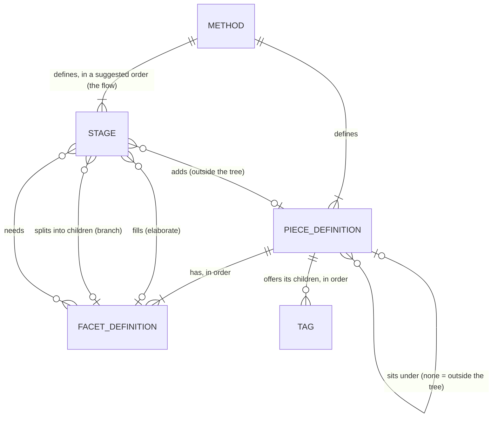
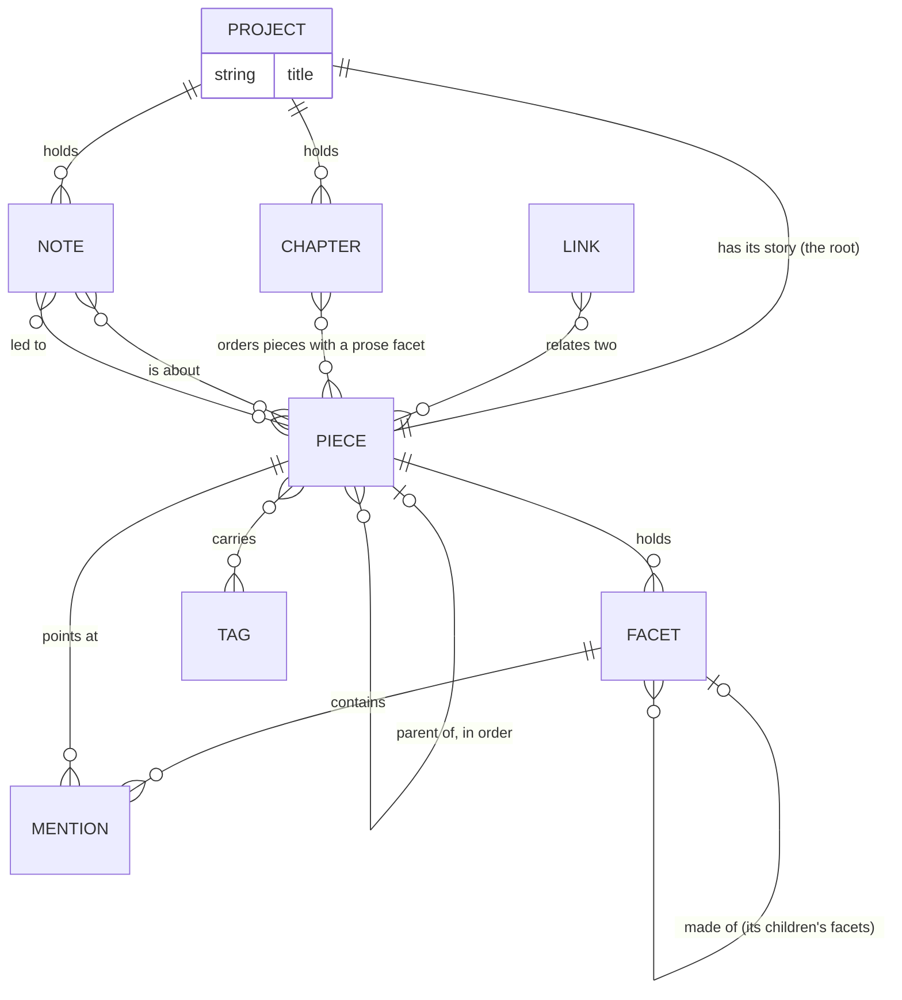
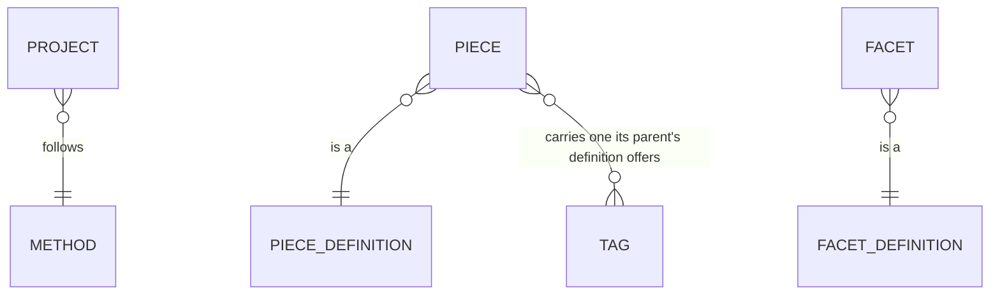

# Domain model

**Audience:** anyone writing a story, an epic or a method definition, or naming something in the domain.
**Purpose:** what a method defines and what a project holds, as numbered statements stories can cite.

The model has two parts. The **method** is what a method's author defines, such as Snowflake, extended. The **project** is what a writer makes by following a method: a **story** planned as a tree of pieces, and the **manuscript**, the prose a reader meets. The method's job is to help the writer follow a structured flow: it offers, and the writer chooses.

The [ubiquitous language](ubiquitous-language.md) says what each term means.

## The method

1. A method defines every piece definition (its structure) and its stages (its flow).
2. Many methods include the same piece definitions, such as character, place and theme, and a new method starts from them. A method includes them, changes them or leaves them out; the model does not insist on any.
3. A piece definition lists its facet definitions in the order they are elaborated, and may name the definition whose pieces sit under it.
4. A piece definition says whether its pieces sit in the tree or outside it. Characters, places and themes sit outside the tree. Nothing nests under a piece of its own definition for now.
5. A piece definition may give advice, and may offer tags for its children, each with its own guidance, in a suggested order. Snowflake, extended offers Setup, Disaster 1, Disaster 2, Disaster 3 and Ending for the story's beats.
6. A stage is one step of the flow. It elaborates a piece, filling its next facet; branches it, splitting a facet's parts out into children; or adds a piece of a definition outside the tree.
7. A stage needs zero or more facets, on the piece itself or on its parent. Each piece gets its own copy of these needs, so the stages and needs form a dependency graph that follows the tree.
8. The flow is one suggested order through the graph. The next moves are the stages whose needs are all filled, and the tags no child carries yet, in their suggested order. A branching stage stays a next move while its facet has text not yet split.
9. Structure is enforced: a piece sits only under a parent of the definition its own definition names, so the chain from the story down always exists, even where nothing in it is written.
10. Content is never enforced: a facet may be empty, or filled before the facets it needs. Needs decide what is offered, never what is allowed, and the method never flags the writer's content or structure.
11. A method whose stages need each other in a cycle is refused, since nothing in it could ever be offered. This checks the method's author, never the writer.

## The project

The manuscript is not an entity: it is derived from the chapters and the prose (statement 30).

### The story and its pieces

12. A project holds one story, zero or more chapters and zero or more notes, and follows one method. It has details that describe the book, whatever its method: a title now, and genre and audience when a feature needs them. A method never defines them.
13. The story is the root piece of the tree: what happens, as the writer plans it. Every method has one, whatever its definition calls the pieces below it. A series of stories is out of scope.
14. A piece in the tree has one parent, except the story, which has none. Its children are in order.
15. A piece in the tree may be elaborated and branched. A piece outside the tree is only elaborated, and is made by a stage that adds it or by the writer at any time.
16. A piece holds zero or more facets, each belonging to that piece alone. How many are filled shows how far it has been elaborated.
17. A piece has prose when its definition has a prose facet. In Snowflake, extended, only a scene does.

### Tags

18. The writer may give a piece any tag its parent's definition offers, and the tag's guidance applies to it. Any number of pieces may share a tag, and a piece may have none.

### Branching: splitting a facet into children

19. A facet may be made of parts: text of its own, and parts that are its children's facets.
20. The writer chooses when to split a part out. Splitting makes a child whose facet is that part.
21. The children's order and the order of their parts in the parent's facet are one order.
22. A piece is deleted only when the writer deletes it, never as a result of changing a facet. Deleting a child removes its part from the parent's facet.
23. A parent is made of its children only in the facets that were split. Its other facets remain its own.

### Connections

24. A facet contains zero or more mentions, and each mention points at one piece.
25. A link relates any two different pieces, whatever their definitions, with no direction. A method may offer links or make them through mentions, but never restricts them. A piece linked to itself is refused.
26. Two pieces are linked if a link relates them or a mention in one points at the other.
27. Tags, links, mentions, chapters and notes connect or mark pieces; they do not elaborate them.

### Chapters and the manuscript

28. A chapter orders pieces whose definition has a prose facet, however far they have been elaborated.
29. Such a piece sits in at most one chapter, and no other piece sits in one.
30. The manuscript is derived: the prose read in chapter order, the work as a reader meets it, drawing details such as the title from the project. A piece whose prose is not yet written contributes nothing to it.

### Notes

31. A note is about zero or more pieces, or about a passage of one of their facets. A note about no piece is about the whole story.
32. A note can lead to zero or more pieces: the ones the writer made or changed because of it. An idea for a scene the plan has not reached yet is a note.
33. A note never sits in the tree, a chapter or the manuscript. A note on a passage of a scene's prose belongs to the scene, even where it shows while reading a chapter.
34. A note belongs to the project, not the method: no method defines it, gives it facets or offers stages for it.

## The seam

## Not in the model yet

- **Names:** better words for Graph and Notice. Storyboard and canvas are candidates for Graph.
- **Facets that are choices:** a value shift is picked from a set, not written. Left until a method needs one.
- **Switching method:** changing genre partway through means changing method. The piece definitions both methods include carry over.
- **Outputs:** a pitch synopsis or a logline presents the work to someone else. Proposed: outside the model for now.
- **Custom tags:** left out for now. If they come, a tag is a link to a piece outside the tree, not a parallel system.
- **Link direction and labels:** left until a story needs one, such as a character linked to a character. What is linked carries the meaning meanwhile: a character on a scene appears in it, a place on a scene is where it is set. A dependency often carries order already.
- **Above the project:** a term for a writer's whole body of work (oeuvre, shelf) earns a place only when something lives above the project: a series, pieces shared across books, or a writer's own method. "Projects folder" and "Your projects" are storage and screen words, not domain.
- **Note status**, such as open or done: left until notes exist.
